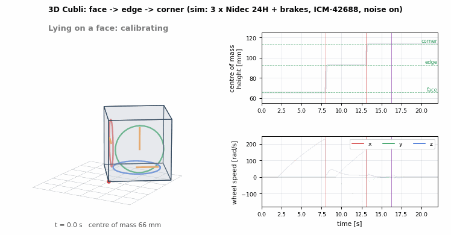

# Cubli 3D (ROS 2 Jazzy)

A 15 cm cube with three reaction wheels. Lying flat on a face, it **jumps onto an edge,
balances there, jumps onto a corner and balances on the corner**, using only its wheels
and their brakes.



*Simulation with all noise sources on. It lies on a face (gyro calibration), spins the
x wheel up and brakes it, and lands balanced on the edge. While still balancing on the
edge, it spins the y and z wheels up and brakes both, and swings up onto the corner. Then
it is pushed. Right: the centre-of-mass height (face 66 mm, edge 93 mm, corner 114 mm)
and the three wheel speeds. Played at 2× speed.*

| Stage | What | Status |
|---|---|---|
| 1D Cubli | One wheel: jump-up and balance on an edge, sensor models and estimator, ESP32 firmware and ROS driver | ✅ done, see **[nht-cyb/ros2-1dim-balancing-cube](https://github.com/nht-cyb/ros2-1dim-balancing-cube)** |
| 3D model | Corner dynamics, floor contact (face / edge / corner), brakes, Nidec motors | ✅ simulation |
| Edge balance | Balancing on an edge with the wheel along it, while the other two wheels prepare the next jump | ✅ simulation |
| Face → edge | Spin up, brake, energy-controlled flight, LQR catch | ✅ simulation |
| Edge → corner | Two wheels braked at once, energy-controlled flight, 3D LQR catch and corner balance | ✅ simulation |
| Noise | ICM-42688 IMU, encoders, motor torque error and ripple, lossy brakes (learned online) | ✅ simulation |
| Hardware | ESP32 with three Nidec channels and brakes, ICM-42688 over SPI, on-board balance loop | 🚧 next |

Everything below is about the 3D cube; the 1D results live in the repository linked above.

## Contents

1. [Hardware being modelled](#1-hardware-being-modelled)
2. [Mathematical model](#2-mathematical-model)
3. [Balancing on an edge](#3-balancing-on-an-edge-with-3-motors)
4. [Jump-up: face → edge](#4-jump-up-face--edge)
5. [Jump-up: edge → corner, and corner balance](#5-jump-up-edge--corner-and-corner-balance)
6. [Sensors, hardware noise and estimation](#6-sensors-hardware-noise-and-estimation)
7. [Results](#7-results)
8. [How to run](#8-how-to-run)
9. [Project layout](#9-project-layout)

## 1. Hardware being modelled

| Part | Model in the simulation | Notes |
|---|---|---|
| Frame | 15 cm cube, 0.75 kg (frame, electronics, battery, motor stators) | MEASURE |
| Wheels | 3 × 0.204 kg, axial inertia I_w = 0.57·10⁻³ kg·m², radius 58 mm, 10 mm thick | MEASURE |
| Motors | 3 × Nidec 24H: stall torque 0.10 N·m, no-load speed 600 rad/s, limited to 0.08 N·m | MEASURE |
| Brakes | one per wheel, hands over a fraction η ≈ 0.92 ± 0.02 of the wheel's momentum | MEASURE |
| IMU | one ICM-42688-class IMU at the cube centre | datasheet noise |
| Encoders | Nidec built-in, 100 PPR × 4 = 400 counts per turn | |
| Total | **M = 1.36 kg** | |

**Wheel placement.** Wheel *i* spins about body axis *i*. Its centre sits 63 mm from the
cube centre, towards the face at the pivot corner. Two orthogonal wheels only miss each
other if this offset is larger than the wheel radius, so three 58 mm wheels clear each
other by 5 mm (checked by a test). All values are in `Cubli3DParams`
([model3d.py](src/cubli_control/cubli_control/model3d.py)).

## 2. Mathematical model

### 2.1 Frames and state

- **Body frame B:** origin at the pivot corner, axes **e₁ e₂ e₃** along the three cube
  edges that meet there. The cube fills [0, s]³ with s = 0.15 m. The three neighbour
  vertices are **v**ᵢ = s **e**ᵢ.
- **State** (13): attitude quaternion **q** (B → world), body rate **ω** (in B), wheel speeds
  relative to the body **ω_w**, and wheel angles **θ_w**.
- **Input:** wheel torques **T**; the body feels −**T**.
- **Up vector:** **u** = Rᵀ **e**_z is world "up" seen from the body. Vertex *i* is at
  height s·uᵢ, so **u** alone tells which vertices touch the floor.

| Geometry | Value |
|---|---|
| Centre of mass **r** (pivot → CoM) | 0.0656 (1, 1, 1) m, on the body diagonal; ‖**r**‖ = 0.114 m |
| Inertia about the pivot, wheels locked: Θ | 0.0170 on the diagonal, −0.0057 off it [kg·m²] |
| Θ₀ = Θ − I_w 𝟙 (wheels spinning freely) | |

### 2.2 Equations of motion (on the corner)

The angular momentum about the pivot is **L** = Θ**ω** + I_w**ω_w**. Euler's equation about
the fixed pivot, and the axial momentum of each wheel, give (after Muehlebach &
D'Andrea, *Nonlinear Analysis and Control of a Reaction-Wheel-Based 3-D Inverted
Pendulum*, IEEE TCST 2017):

  Θ₀ **ω̇** = **h**,  **h** = −**ω** × **L** + M **r** × **g**_B − c_b **ω** − (**T** − c_w **ω_w**)

  I_w (**ω̇** + **ω̇_w**) = **T** − c_w **ω_w**,  **q̇** = ½ **q** ⊗ (0, **ω**)

- **g**_B = −g**u** is gravity in the body frame.
- c_b, c_w are the pivot and wheel-bearing friction.
- The wheel equation is exact for symmetric wheels: the gyroscopic term has no component
  along a wheel's own axis.

### 2.3 Floor contact: face, edge or corner

The cube always pivots on the same corner. The **contact set** C ⊆ {1, 2, 3} is the set of
neighbour vertices on the floor, and it selects the dynamics:

| C | Pose | Body dynamics |
|---|---|---|
| ∅ | on the corner | Θ₀ **ω̇** = **h** (free rotation about the pivot) |
| {i} | on edge i | **ω** = φ̇ **e**ᵢ, with Θ₀,ᵢᵢ φ̈ = hᵢ (the contact forces have no moment about the edge line) |
| {i, j} | lying on a face | **ω** = 0 |

The wheels always follow **ω̇_w** = (**T** − c_w **ω_w**)/I_w − **ω̇**.

- **Contact torque and normal force.** The floor's torque about the pivot is
  **τ**_c = Θ₀ **ω̇** − **h**. The vertical force on vertex *i* is then
  Nᵢ = **u** · ((**τ**_c / s) × **e**ᵢ).
- **Lift-off:** if Nᵢ < 0 (the floor would have to pull), vertex *i* leaves the contact set.
- **Landing** is inelastic. When vertex *i* reaches the floor, only the angular momentum
  about the new contact edge survives: φ̇⁺ = (Θ **ω**⁻)ᵢ / Θᵢᵢ. Landing on a face stops the
  body.
- A cube falling off the corner always lands on one of the three edges through the pivot,
  at 35.26° of tilt. A cube falling off an edge lands on a face at ±45°.

The simulator integrates this with RK4 at 200 Hz. Tests check that it conserves energy on
an edge (10⁻⁸) and keeps the momentum about the landing edge. Code:
[contact3d.py](src/cubli_control/cubli_control/contact3d.py).

### 2.4 Brakes

Braking wheels B ⊆ {1, 2, 3} is an impulse. Their momentum I_w ω_w,j goes to the body,
times the brake efficiency η:

  Θ **ω**⁺ = Θ **ω**⁻ + η I_w Σⱼ∈B ω_w,j **e**ⱼ,  ω_w,j⁺ = 0

Then the contact set decides: a vertex whose new velocity points upwards lifts off, and
the rest constrain **ω**⁺ (projected onto the remaining edge, or zero on a face). After the
impulse the wheel is free again and keeps spinning with the body. So only ½Θ₀φ̇² is left to
lift the cube, not ½Θφ̇². This sets the jump speeds below.

### 2.5 Motors

Each Nidec motor gives at most the torque its effort range allows at the current wheel
speed (back-EMF), and the controller limits it further to 0.08 N·m:

  τ_stall (−1 − ω_w/ω₀) ≤ T ≤ τ_stall (1 − ω_w/ω₀)

## 3. Balancing on an edge with 3 motors

On edge *i* only rotation about **e**ᵢ is free, so **only wheel *i* can balance the cube**.
The two wheels perpendicular to the edge push their reaction torques into the floor. They
are used to hold their speed, or to store momentum for the next jump (section 5).

Write **r**⊥ = **r** − (**r**·**e**ᵢ)**e**ᵢ (the CoM offset from the edge, ‖**r**⊥‖ = 92.7 mm) and
**n** = **e**ᵢ × **r̂**⊥. The edge tilt φ is defined by **u** = cos φ **r̂**⊥ − sin φ **n**, so
φ̇ = ωᵢ. With this, the edge dynamics are exactly a 1D Cubli:

  Θ₀,ᵢᵢ φ̈ = M g ‖**r**⊥‖ sin φ − c_b φ̇ − (Tᵢ − c_w ω_w,i)

  ω̇_w,i = (Tᵢ − c_w ω_w,i)/I_w − φ̈

- **Open loop:** unstable, with a pole at +8.64 rad/s.
- **Controller:** a discrete LQR on [φ, φ̇, ω_w,i] with Q = diag(100, 0.3, 10⁻⁴) and R = 100
  gives K = [−3.18, −0.353, −0.0010].
- **Engaging and giving up:** it takes over within `edge_catch` = 0.4 rad of balance if the
  cube is moving towards balance. It gives up beyond 0.16 rad while still tipping further.
- **The motor limits it.** Gravity's stiffness about the edge is M g ‖**r**⊥‖ = 1.24 N·m/rad,
  so 0.08 N·m holds at most **3.7°**. With all the noise on, it recovers from a 3° start but
  not from 3.5°.

## 4. Jump-up: face → edge

Lying on the face spanned by **e**ᵢ and **e**ⱼ, the cube jumps onto edge *i* by spinning
wheel *i* and braking it.

1. **Required wheel speed.** The CoM has to rise from rᵤ (its height on the face) to
   ‖**r**⊥‖: ΔE = M g (‖**r**⊥‖ − rᵤ) = 0.363 J. The brake gives φ̇₀ = I_w ω_w / Θᵢᵢ, of which
   ½Θ₀,ᵢᵢφ̇₀² is usable, so

     ω_w = (Θᵢᵢ / I_w) √(2 ΔE / Θ₀,ᵢᵢ) = **198 rad/s** (lossless)

   The target is margin × 198 / η̂, i.e. 229 rad/s with the default margin of 1.04 and a
   first efficiency guess of η̂ = 0.9.
2. **Spin-up:** a speed loop limited to 0.03 N·m. Its reaction torque presses the cube into
   the floor, so it stays put (the contact model checks this). The brake fires only once
   the speed has held within ±2 rad/s for 0.15 s.
3. **Flight energy control.** Between the brake and the top, the energy about the edge is
   E = ½ Θ₀,ᵢᵢ φ̇² + M g ‖**r**⊥‖ cos φ, and only the motor changes it: Ė = −Tᵢ φ̇. So
   during the flight

     Tᵢ = sat(k_E (E − E*) φ̇),  E* = M g ‖**r**⊥‖

   steers the cube to arrive at balance with no speed left. With 0.08 N·m over the 45°
   flight, this corrects about ±15% of the jump energy, i.e. ±7% of the brake momentum.
4. **Catch:** within `edge_capture` = 0.15 rad the edge LQR takes over.
5. **If it misses:** it lands on a face (the starting face means short, the other face means
   overshot), or it is caught and lost again within 1 s. The margin then moves by ±0.01 and
   it tries again.

## 5. Jump-up: edge → corner, and corner balance

### 5.1 The jump

From balance on edge *i*, the cube swings up about the horizontal axis **n** = **e**ᵢ × **r̂**⊥
through the pivot, lifting the far end of the edge. Wheel *i* keeps balancing the edge
throughout. The other two wheels store the jump momentum:

- **Jump axis.** By the cube's symmetry, **n** is an eigenvector of Θ (for edge 1,
  **n** = (0, −1, 1)/√2). So wheel momentum along **n** makes the body turn about **n**
  alone, with no wobble.
- **Required speeds.** ΔE = M g (‖**r**‖ − ‖**r**⊥‖) = 0.278 J, and with λ₀ = **n**ᵀΘ₀**n**:

    **ω_w** = (Θ **n** / I_w) √(2 ΔE / λ₀),  so (ω_w,j, ω_w,k) = (∓141, ±141) rad/s lossless

- **Spin-up while balancing:** the two wheels spin up (162 rad/s with the margins). Their
  reaction torque lies along −**n** and presses the far vertex into the floor.
- **Brake:** once the wheels have settled and the edge is calm (|φ| < 0.5°), both wheels are
  braked at once. The far vertex lifts off and the cube rotates about the corner.
- **Flight energy control** works as on the edge, about **n**:
  E = ½ λ₀ ω_n² + M g (**r**·**u**), with wheel torques **T** = sat(k_E (E − E*) ω_n) **n**.
- **Catch:** within `corner_capture` = 0.15 rad of corner balance the corner LQR takes over.

### 5.2 Corner balance

Yaw doesn't matter for balance: gravity doesn't act on it, and an IMU can't measure it.
So the controller works with two **tilt coordinates** instead of a full attitude. At
upright **u** = **r̂**. For unit vectors **a**, **b** ⟂ **r̂**, near upright
**u** ≈ **r̂** + p_a**a** + p_b**b**. With **u̇** = **u** × **ω**, the linearised model in
**z** = [p_a, p_b, **ω**, **ω_w**] ∈ ℝ⁸ is:

  ṗ_a = (**a**×**r̂**)·**ω**,  ṗ_b = (**b**×**r̂**)·**ω**

  Θ₀ **ω̇** = −M g ‖**r**‖ (p_a **r̂**×**a** + p_b **r̂**×**b**) − c_b **ω** + c_w **ω_w** − **T**

  **ω̇_w** = (**T** − c_w **ω_w**)/I_w − **ω̇**

This matches finite differences of the nonlinear model to 10⁻⁸ (tested).

- **Open loop:** a pair of unstable poles at +8.24 rad/s, one per tilt direction.
- **Controller:** a discrete LQR **T** = −K**z** with Q = diag(100, 100, 0.3 × 3, 10⁻³ × 3) and
  R = 100·𝟙. K (3 × 8) has the cube's 3-fold symmetry.
- **Giving up:** beyond 0.1 rad while tipping further, i.e. (**u** × **ω**)·**r̂** < 0, or
  beyond 0.3 rad. A cube that falls off the corner lands near edge balance, and the edge
  LQR catches it if it can.
- **Limits:** three wheels at 0.08 N·m hold the cube statically up to 4.3–4.9° of tilt.
  From rest the LQR catches it from up to 3.4°. On the corner it recovers from pushes up to
  about 0.5 rad/s.

## 6. Sensors, hardware noise and estimation

| Source | Model | Value |
|---|---|---|
| Gyro | white noise + constant bias per axis | 5·10⁻⁴ rad/s (ICM-42688, ~100 Hz bandwidth); bias ~0.3–0.5°/s |
| Accelerometer | white noise + bias, at the cube centre (feels the cube's own rotation) | 0.007 m/s²; bias 0.015–0.025 m/s² after a one-time calibration |
| Encoders | quantised | 400 counts per turn |
| Motor torque constant | true torque = scale × commanded | 0.95 in the ROS sim (0.90–1.05 in the Monte Carlo) |
| Torque ripple | Gaussian | 3% of the torque + 0.5 mN·m |
| Back-EMF | Nidec limits (section 2.5) | |
| Brakes | efficiency per brake ~ N(η, 0.02) | η = 0.92 in the ROS sim (0.85–0.97 in the Monte Carlo) |
| Control delay | one 5 ms step | |

The controller only knows the nominal model. It sees the estimator's output, never the
true state.

**Up-vector estimator** ([estimator3d.py](src/cubli_control/cubli_control/estimator3d.py)):

1. **Calibration:** with the cube still for 1 s (lying on a face, or held), average the gyro
   for its bias and the accelerometer for the starting **u**.
2. **Prediction:** rotate **u** by −**ω** dt (exact Rodrigues rotation).
3. **Correction:** blend in the accelerometer direction with τ = 0.5 s. First remove the
   IMU's own acceleration, **ω̇** × **r**_imu + **ω** × (**ω** × **r**_imu). Skip the correction
   while ‖**f**‖ is more than 1 m/s² away from g, or the rate is above 3 rad/s (jumps,
   landings).
4. **Wheel speeds** come from 8-sample encoder differences.
5. **Pose:** which vertices touch the floor comes from **u** alone (vertex *i* counts as down
   below uᵢ < 0.05), so no contact sensor is needed.

**Learning the brakes.** Each brake's efficiency is measured from the first sample where it
shows:

  η = (**a**·Θ**ω** after − **a**·Θ**ω** before − **a**·**τ**_g Δt) / (**a**·I_w Δ**ω_w**)

- **a** is the jump axis: **e**ᵢ for face → edge, **n** for edge → corner.
- **τ**_g Δt adds back the gravity impulse since the brake. Without it the estimate is
  10–23% too low, because gravity is already slowing the jump.
- The average of the last five brakes scales the next spin-up targets by 1/η̂. In
  simulation it lands within ±0.01 of the true value.

## 7. Results

**Monte Carlo** ([scripts/monte_carlo_3d.py](scripts/monte_carlo_3d.py), raw output in
[tuning/phase4_monte_carlo.txt](tuning/phase4_monte_carlo.txt)). There are 40 runs of
30 s each, every one with its own hardware: torque constant 0.90–1.05, brake efficiency
0.85–0.97 ± 0.02 per brake, and random IMU biases. Each starts lying on a face, and the
controller knows none of this.

| Result | Value |
|---|---|
| Balanced on the corner at the end | **40 / 40** |
| Jumps needed (face → edge / edge → corner) | 1 / 1 in 26 runs; 2 / 1 in 13; 3 / 1 in 1. Every corner jump worked first time |
| Time from lying on a face to balanced on the corner | median 13.6 s (8.2 s to the edge), max 29.2 s |
| Corner tilt while balanced (true, last 3 s) | median 0.005° RMS |
| Brake efficiency learned vs. true | within ±0.03 in every run |
| Highest wheel speed | 264 rad/s (Nidec no-load: 600) |

All the missed jumps were face → edge jumps. In 11 of the 14 runs with a miss, the brake
was unusually good (η ≥ 0.94): against the first guess of 0.9, the jump overshot by more
than the flight energy control can take back. The other three (η = 0.85–0.92) missed on the
per-brake scatter. After a brake the controller knows η better, and the retry works.

**ROS run** (`cubli3d_sim.launch.py`, all noise on): face → edge → corner on the first try.
On the corner the true tilt was 0.17° RMS (settling after the catch included). A 0.3 rad/s
push peaked at 1.0° and settled back to 0.08°. `start:=edge jump_to_corner:=false`
balances on the edge indefinitely.

**Tests:** 28 for the 3D model, contacts, brakes, controllers and the full sequence
([test_model3d.py](src/cubli_control/test/test_model3d.py),
[test_jump3d.py](src/cubli_control/test/test_jump3d.py)).

**What limits it:** the motors. 0.08 N·m per wheel holds the 1.36 kg cube only within
about 3.7° on an edge and 3.4–4.9° on the corner. That is why the jumps need their speed
controlled during the flight rather than just a well-timed brake. Stronger motors, or a
lighter cube with a lower centre of mass, would widen every margin here.

## 8. How to run

**One-time setup:**

```bash
sudo apt install python3-colcon-common-extensions
```

ROS Jazzy needs the system Python 3.12. If a conda env is active (`(base)` in your
prompt), run `conda deactivate` first.

**Build** (from `cubli_ws`):

```bash
colcon build --symlink-install
```

```bash
source install/setup.bash
```

**Full jump-up demo:** starts lying on a face, then goes face → edge → corner:

```bash
ros2 launch cubli_control cubli3d_sim.launch.py
```

- In the log: `Calibrated`, then `SPIN_EDGE`, `JUMP_EDGE` (brake), `EDGE caught on edge 0`,
  `SPIN_CORNER`, `JUMP_CORNER`, `CORNER caught on the corner`. The sim logs each brake's
  true efficiency and every contact change.
- RViz shows the cube (fixed frame `world`) with the three wheels spinning.
- Add `rviz:=false` to run without RViz.

**Other starts:**

```bash
ros2 launch cubli_control cubli3d_sim.launch.py start:=edge jump_to_corner:=false
```

```bash
ros2 launch cubli_control cubli3d_sim.launch.py start:=corner
```

With `start:=edge` or `start:=corner` the cube is held still for the gyro calibration and
then let go. `jump_to_corner:=false` keeps it on the edge.

**Interact** (in a second terminal, after `source install/setup.bash`):

```bash
ros2 topic pub --once /cubli/push geometry_msgs/msg/Vector3 "{x: 0.3, y: 0.0, z: 0.0}"
```

```bash
ros2 service call /cubli/reset std_srvs/srv/Trigger
```

```bash
ros2 topic echo /cubli/mode
```

```bash
ros2 run rqt_plot rqt_plot /cubli/tilt/data /cubli/ground_truth/tilt/data
```

- The push is a world-frame angular velocity kick in rad/s. On the corner up to about 0.5
  is recovered.
- Reset puts the cube back in its start pose.
- `/cubli/tilt` is the estimated tilt from corner balance; `/cubli/ground_truth/tilt` is the
  true one.

**Tune:** [config/cubli3d.yaml](src/cubli_control/config/cubli3d.yaml) holds:
- motor, brake and IMU noise (`cubli3d_sim`);
- the filter (`cubli3d_estimator`);
- the LQR weights, catch angles, jump margins and energy gain (`cubli3d_controller`).

**Offline tools:**

```bash
cd src/cubli_control && /usr/bin/python3 -m pytest test/test_model3d.py test/test_jump3d.py
```

```bash
python3 scripts/monte_carlo_3d.py 40
```

```bash
python3 scripts/render_phase4_gif.py media/cubli3d_jump_up.gif
```

**Topics:**

| Topic | From → to | Content |
|---|---|---|
| `/imu/data_raw` | sim → estimator | gyro + accelerometer, body axes |
| `/cubli/wheel_encoders` | sim → estimator | quantised wheel angles |
| `/cubli/state_estimate` | estimator → controller | up vector, body rate, wheel speeds |
| `/cubli/wheel_torques` | controller → sim | 3 torques [N·m] |
| `/cubli/brake` | controller → sim | wheels to brake |
| `/cubli/mode`, `/cubli/tilt` | controller | mode, estimated tilt |
| `/tf` world → cube, `/joint_states` | sim → RViz | true attitude and wheel angles |

## 9. Project layout

```
src/cubli_description/
├── urdf/cubli_3d.urdf          cube, pivot and the three wheels
└── rviz/cubli3d.rviz
src/cubli_control/
├── cubli_control/
│   ├── model3d.py              corner dynamics, parameters, motor limits, linearisation, corner LQR
│   ├── contact3d.py            face / edge / corner contact, lift-off, landing, brakes
│   ├── control3d.py            edge LQR, jump state machine, flight energy control, brake learning
│   ├── sensors3d.py            ICM-42688 IMU + encoder models
│   ├── estimator3d.py          up-vector estimator + wheel speeds
│   ├── sim3d.py                simulator core (plant + noise) and the offline closed loop
│   ├── sim3d_node.py           ROS: simulator
│   ├── estimator3d_node.py     ROS: estimator
│   └── controller3d_node.py    ROS: controller
├── config/cubli3d.yaml
├── launch/cubli3d_sim.launch.py
└── test/test_model3d.py, test/test_jump3d.py
scripts/monte_carlo_3d.py       robustness study
scripts/render_phase4_gif.py    the GIF above
```

The package still contains the 1D Cubli code (`sim_node`, `controller_node`,
`hw_driver_node`, the ESP32 sketch in `firmware/`, …). It is documented in the
[1D repository](https://github.com/nht-cyb/ros2-1dim-balancing-cube).

**Next:** an ESP32 with three Nidec channels and three brakes, the ICM-42688 over SPI, and
the edge/corner balance loop running on the board. Then bring-up, and measuring the
masses, inertias, motor constants and brake efficiency marked MEASURE.
